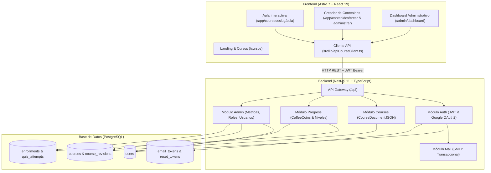
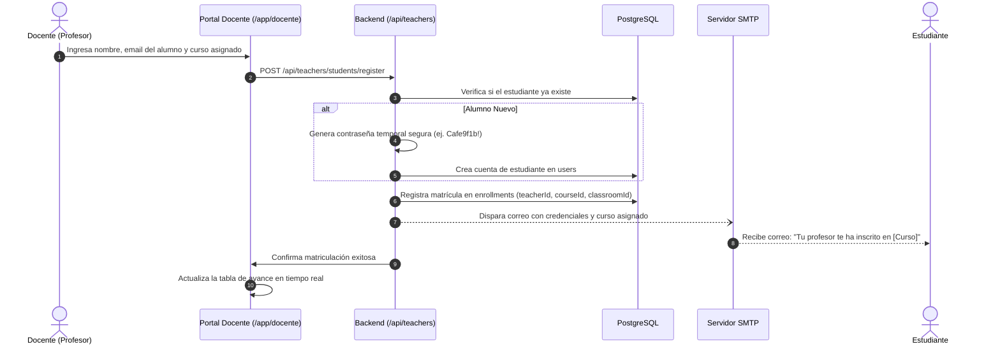
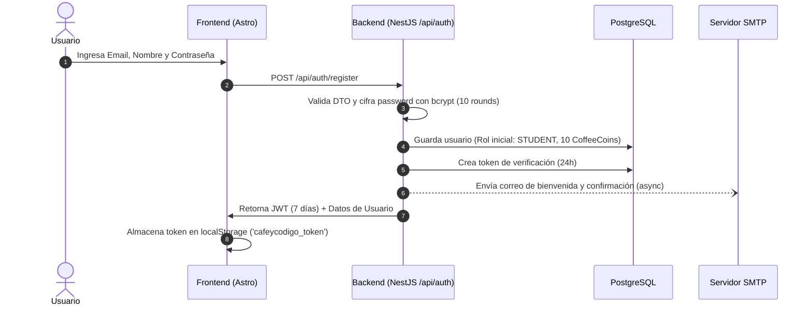

# 🏗️ Arquitectura del Sistema: Café y Código (Frontend + Backend)

Este documento describe la arquitectura global, los perfiles de usuario, el flujo de autenticación, el sistema de correo transaccional y cómo se conectan los módulos interactivos de `/app` (Astro + React) con el backend en **NestJS** y la base de datos **PostgreSQL**.

---

## 🗺️ Visión General del Ecosistema



---

## 👥 Perfiles y Matriz de Roles

La plataforma divide los accesos en **cuatro roles principales** definidos en la base de datos y validados mediante `@Roles(...)` y `RolesGuard` en NestJS:

| Rol | Alcance y Propósito | Permisos y Rutas Permitidas |
| :--- | :--- | :--- |
| **🎓 Estudiante (`STUDENT`)** | Usuario regular que consume cursos, practica programación y participa en desafíos. | • Iniciar sesión con email o Google.<br>• Acceder a las aulas interactivas (`/app/courses/[slug]/aula`).<br>• Guardar progreso de lectura y respuestas de cuestionarios.<br>• Acumular CoffeeCoins y subir de nivel (*Americano* → *Ristretto*).<br>• Consultar su perfil y tablas de clasificación (`/api/progress/leaderboard`). |
| **👨‍🏫 Docente / Profesor (`TEACHER`)** | Profesor a cargo de comisiones y grupos de estudiantes. | • Todo lo del Estudiante.<br>• Acceder al **Portal Docente** (`/app/docente/`).<br>• **Crear comisiones / aulas** con códigos únicos de clase.<br>• **Matricular directamente a sus alumnos** por nombre y correo.<br>• Generar contraseñas temporales y notificar a los alumnos por email.<br>• **Monitorear el avance grupal e individual** (% temario completado, notas de retos, último acceso). |
| **✏️ Editor (`EDITOR`)** | Creador de contenido educativo o diseñador instruccional. | • Todo lo del Estudiante.<br>• Acceder al Creador de Contenidos (`/app/contenidos/crear` y `/administrar`).<br>• Crear, editar y guardar la jerarquía completa de cursos (`CourseDocumentJSON`).<br>• Gestionar borradores (`DRAFT`) y enviar a publicación (`PUBLISHED`).<br>• Ver y recuperar revisiones previas de un curso (`/api/courses/:id/revisions`). |
| **👑 Administrador (`ADMIN`)** | Control absoluto técnico y de gestión de la plataforma. | • Acceso total a todos los módulos (Estudiante, Docente, Editor).<br>• Acceso exclusivo al **Dashboard Administrativo** (`/admin/dashboard`).<br>• Consultar métricas globales (usuarios, cursos, economía de CoffeeCoins).<br>• Listar y buscar usuarios registrados con filtros avanzados.<br>• **Promover o degradar roles** (`STUDENT` ↔ `TEACHER` ↔ `EDITOR` ↔ `ADMIN`) en tiempo real.<br>• Otorgar o ajustar saldos de CoffeeCoins.<br>• Eliminar cursos o gestionar estados globales. |

---

## 👨‍🏫 Flujo del Perfil Docente (Matriculación y Seguimiento)



### Endpoints del Portal Docente (`/api/teachers`)
* `GET /api/teachers/dashboard`: Resumen de comisiones activas, alumnos matriculados y promedio de avance grupal.
* `GET /api/teachers/classrooms`: Lista de aulas creadas por el docente con conteo de inscritos.
* `POST /api/teachers/classrooms`: Creación de aula con código único de clase (ej. `ALGO-A26`).
* `POST /api/teachers/students/register`: Matricula al alumno, genera sus credenciales iniciales si es nuevo y le envía el correo SMTP.
* `GET /api/teachers/classrooms/:id/students`: Seguimiento detallado por alumno: porcentaje completado de la asignatura, widgets completados de total, quizzes rendidos/aprobados y último acceso.

---

## 🔐 Flujo de Autenticación y Seguridad

### 1. Registro e Inicio de Sesión Tradicional


### 2. Autenticación con Google (Google Sign-In / One Tap)
* **Modo A (Directo con One Tap / Botón GIS):**
  1. El frontend obtiene el `idToken` firmado de Google.
  2. Envía `POST /api/auth/google/token` con `{ idToken }`.
  3. NestJS valida el token criptográficamente con `OAuth2Client` de `google-auth-library`.
  4. Si el usuario no existe, se crea con su foto de perfil y email verificado; si ya existía, se vincula el `googleId`.
  5. Retorna el JWT propio de Café y Código.
* **Modo B (Redirección OAuth2 estándar):**
  1. Frontend navega a `GET /api/auth/google`.
  2. Google solicita consentimiento y redirige a `GET /api/auth/google/callback`.
  3. NestJS emite el JWT y redirige al frontend con `?token=...`.

---

## 📬 Sistema de Correos Transaccionales (SMTP)

El backend incorpora un `MailService` centralizado sobre `nodemailer`:
- **Configuración desacoplada en `.env`:**
  - `SMTP_HOST`: Dirección del servidor de correos (ej. `smtp.gmail.com`, `mail.tudominio.com`).
  - `SMTP_PORT`: Puerto seguro (`587` para STARTTLS o `465` para SSL).
  - `SMTP_SECURE`: `true` o `false`.
  - `SMTP_USER` y `SMTP_PASS`: Tus credenciales SMTP.
  - `SMTP_FROM`: Identidad remitente (ej. `"Café y Código" <no-reply@cafeycodigo.org>`).
- **Plantillas HTML Neobrutalistas incluidas:**
  - ☕ **Bienvenida:** Notifica el registro, asigna el nivel inicial *Americano* y regala las primeras CoffeeCoins.
  - 🔐 **Verificación de correo:** Botón con enlace firmado y token único temporal.
  - 🔑 **Restablecimiento de contraseña:** Flujo seguro con expiración de 1 hora.

---

## 📦 Conexión entre los Módulos de `/app` y PostgreSQL

### Estructura de Datos de un Curso (`CourseDocumentJSON`)
En `/app/contenidos/crear/` y `/app/contenidos/administrar/`, los cursos se diseñan mediante una estructura tridimensional:
```
Asignatura (CourseDocumentJSON)
 └── Módulos (CourseModule[])
      └── Lessions (CourseLession[])
           └── Secciones (CourseSeccion[])
                └── Contenidos (CourseContenido[])
                     └── Widget (CourseWidgetBlock) -> [Quiz, Drag&Drop, Code, Video, Slider...]
```

### ¿Cómo se guardan y leen los datos?
1. **Guardado desde el Creador (`/app/contenidos/crear`):**
   * El cliente de Astro invoca `saveCourseToBackend(document)` en [`src/lib/apiCourseClient.ts`](file:///c:/Users/benja/Desktop/aprende/src/lib/apiCourseClient.ts).
   * Se envía a `POST /api/courses` con el token del usuario (requiere rol `EDITOR` o `ADMIN`).
   * NestJS guarda el documento en la tabla `courses` (columna `document` de tipo `JSONB`) y crea una copia en `course_revisions` para historial y auditoría.

2. **Lectura desde el Aula (`/app/courses/[slug]/aula`):**
   * El aula solicita `GET /api/courses/:slug`.
   * El backend entrega el documento completo validado.
   * La interfaz de Astro y React renderiza el módulo actual, el índice de lecciones y el widget activo paso a paso.

3. **Persistencia del Progreso del Alumno:**
   * Al terminar un widget o sección: `POST /api/progress/:courseId/complete`
     * Registra el ID del contenido completado en la tabla `enrollments`.
     * Entrega automáticamente CoffeeCoins y puntos de experiencia.
   * Al contestar un reto interactivo o examen: `POST /api/progress/:courseId/quiz`
     * Registra el puntaje, si aprobó o falló y las respuestas en `quiz_attempts`.
     * Actualiza el nivel de usuario en tiempo real:
       * ☕ **Americano:** 0 – 99 pts
       * 🥛 **Latte:** 100 – 499 pts
       * 🍫 **Macchiato:** 500 – 999 pts
       * ⚡ **Espresso:** 1,000 – 2,499 pts
       * 👑 **Ristretto:** 2,500+ pts

---

## 🖥️ Dashboard Administrativo Conectado

Ubicado en: [`/admin/dashboard/`](file:///c:/Users/benja/Desktop/aprende/src/pages/admin/dashboard.astro)

Se integra directamente con los endpoints administrativos de NestJS:
- **`GET /api/admin/stats`**: Resumen en tiempo real de estudiantes, editores, admins, cursos y CoffeeCoins.
- **`GET /api/admin/users`**: Listado de alumnos y creadores con buscador y filtro por rol.
- **`PATCH /api/admin/users/:id/role`**: Cambio instantáneo de rol con selector desplegable (Estudiante ↔ Editor ↔ Administrador).
- **`PATCH /api/admin/users/:id/coins`**: Asignación de CoffeeCoins de bonificación o corrección de saldo.
- **`GET /api/admin/courses`**: Monitoreo de cursos cargados en la base de datos con cantidad de inscritos y acceso directo al aula.
- **`GET /api/admin/activities`**: Feed cronológico de nuevos registros, retos completados y modificaciones a cursos.

---

## 📁 Estructura del Monorepo

```
cafeycodigo/
├── frontend/                     # Aplicación Web (Astro 7 + React 19 + Tailwind CSS)
│   ├── src/                      # Páginas, componentes, datos y estilos del aula
│   ├── public/                   # Recursos estáticos (badges, contenidos JSON)
│   ├── package.json              # Dependencias de frontend
│   └── astro.config.mjs          # Configuración de Astro
│
├── backend/                      # API Backend (NestJS 11 + TypeScript + Prisma)
│   ├── prisma/                   # schema.prisma y seed.ts
│   ├── src/                      # Módulos: auth, teachers, courses, progress, admin, mail
│   └── package.json              # Dependencias de backend
│
├── package.json                  # Orquestador del monorepo con scripts unificados
├── ARQUITECTURA.md               # Esta documentación técnica
├── DEPLOY_DEBIAN_13.md           # Guía de despliegue en servidor Debian 13 + Nginx
└── MIGRACIONES_Y_SEEDERS.md      # Guía de base de datos, migraciones y seeders
```

---

## ⚡ Comandos Rápidos de Ejecución (Desde la Raíz)

Puedes controlar ambos entornos cómodamente desde la carpeta raíz:

```bash
# Iniciar Frontend (Astro en http://localhost:4321)
npm run dev:frontend

# Iniciar Backend (NestJS en http://localhost:3001/api)
npm run dev:backend

# Compilar ambos proyectos para producción
npm run build

# Base de datos (Prisma)
npm run prisma:push               # Sincronizar esquemas en PostgreSQL
npm run prisma:seed               # Cargar datos de prueba (Admin, Docente, Curso)
npm run prisma:studio             # Abrir panel visual en http://localhost:5555
```

