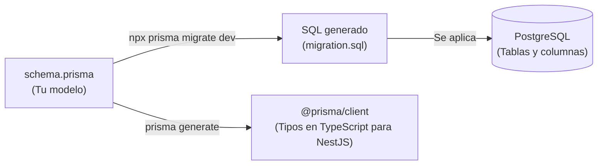

# 🗄️ Guía Completa de Migraciones y Seeders (Prisma + PostgreSQL)

Esta guía explica en detalle cómo funcionan las **migraciones de base de datos** con **Prisma ORM**, qué ocurre cuando modificas el esquema (`schema.prisma`), cómo se actualiza el backend en NestJS y cómo funcionan los **seeders** (semillas de datos iniciales).

---

## 🧭 1. ¿Qué es una Migración y cómo funciona?

En el backend de **Café y Código**, la única **fuente de la verdad** para la estructura de la base de datos es el archivo:
📁 [`backend/prisma/schema.prisma`](file:///c:/Users/benja/Desktop/aprende/backend/prisma/schema.prisma)

Cuando defines o cambias un modelo en ese archivo (por ejemplo, agregas una columna o creas una nueva tabla), la base de datos PostgreSQL en sí **no cambia automáticamente**. Una **migración** es el proceso controlado que:

1. Compara tu modelo actual de `schema.prisma` con el estado previo.
2. Genera un archivo con código SQL puro (`migration.sql`) dentro de `backend/prisma/migrations/`.
3. Aplica ese SQL a PostgreSQL de manera transaccional.
4. Registra la migración aplicada en una tabla interna llamada `_prisma_migrations` para no repetirla.
5. Ejecuta automáticamente `prisma generate` para actualizar los tipos de TypeScript de `@prisma/client`.



---

## 🔄 2. ¿Qué pasa si cambio algo? (Flujo Paso a Paso)

### 📌 Escenario A: Agregar un nuevo campo o tabla (Recomendado para producción)

Imagina que quieres agregar un campo `phone` opcional al usuario, o crear una nueva tabla de `Certificados`.

#### Paso 1: Edita el archivo `schema.prisma`
Abre [`backend/prisma/schema.prisma`](file:///c:/Users/benja/Desktop/aprende/backend/prisma/schema.prisma) y modifica el modelo:

```prisma
model User {
  id        String   @id @default(uuid())
  email     String   @unique
  name      String
  phone     String?  // <-- NUEVO CAMPO OPCIONAL
  // ... resto de campos
}
```

> [!IMPORTANT]
> Si agregas un campo a una tabla que **ya tiene datos**, hazlo **opcional (`?`)** o agrégale un valor por defecto con `@default(...)`. De lo contrario, la base de datos fallará porque no sabrá qué valor ponerle a las filas existentes.

#### Paso 2: Ejecuta la migración en tu terminal
Dentro de la carpeta `backend`:

```powershell
cd backend
npx prisma migrate dev --name agregar_telefono_usuario
```

**¿Qué hace este comando automáticamente?**
1. Detecta que agregaste `phone`.
2. Crea una carpeta `prisma/migrations/20261113_agregar_telefono_usuario/migration.sql` con el SQL:
   ```sql
   ALTER TABLE "users" ADD COLUMN "phone" TEXT;
   ```
3. Ejecuta el SQL en tu PostgreSQL.
4. Regenera el cliente `@prisma/client`.

#### Paso 3: Úsalo de inmediato en NestJS
Dado que Prisma regeneró los tipos, en cualquier servicio o controlador de NestJS (`auth.service.ts`, `users.service.ts`, etc.) ahora tendrás autocompletado y tipado estricto para `user.phone`.

---

### 📌 Escenario B: Prototipado rápido en desarrollo local (`prisma db push`)

Si estás probando ideas rápidamente en tu máquina y **no quieres llenar la carpeta de archivos `.sql`** por cada cambio menor:

```powershell
cd backend
npm run prisma:push
```

* **Qué hace:** Sincroniza directamente tu `schema.prisma` con la base de datos PostgreSQL sin crear archivos de migración históricos.
* **Cuándo usarlo:** Durante el desarrollo inicial local.
* **Cuándo NO usarlo:** En servidores compartidos, staging o producción (donde siempre se debe usar `prisma migrate`).

---

### 📌 Escenario C: Si cometes un error o la base de datos local queda inconsistente

Si en tu entorno local de pruebas quieres reiniciar la base de datos desde cero, borrar tablas rotas y dejar todo limpio:

```powershell
cd backend
npx prisma migrate reset
```
* Borra todas las tablas.
* Aplica todas las migraciones en orden cronológico.
* Ejecuta automáticamente el archivo de semillas (**Seeder**).

---

## 🌱 3. ¿Qué son los Seeders y cómo funcionan?

Un **Seeder** (semilla de datos) es un script que puebla automáticamente tu base de datos con información inicial necesaria para que el sistema funcione desde el primer segundo sin tener que crear todo a mano.

En **Café y Código**, ya dejamos configurado y listo el seeder en:
📁 [`backend/prisma/seed.ts`](file:///c:/Users/benja/Desktop/aprende/backend/prisma/seed.ts)

### ¿Qué datos iniciales crea este Seeder?
Al ejecutarse, crea automáticamente:
1. 👑 **1 Administrador:** `admin@cafeycodigo.org` (Password: `AdminPassword2026!`, Nivel *Ristretto*, 500 CoffeeCoins).
2. 👨‍🏫 **1 Docente / Profesor:** `profesor@cafeycodigo.org` (Password: `ProfePassword2026!`, Nivel *Espresso*).
3. ✏️ **1 Editor:** `editor@cafeycodigo.org` (Password: `EditorPassword2026!`, Nivel *Macchiato*).
4. 🎓 **1 Estudiante:** `estudiante@cafeycodigo.org` (Password: `AlumnoPassword2026!`, Nivel *Latte*, 45 CoffeeCoins).
5. 📚 **1 Curso publicado de `/app`:** *"Primeros pasos con algoritmos"* (`primeros-pasos-algoritmos`) con su documento JSON de módulos y widgets.
6. 🏫 **1 Aula / Comisión:** *"Algoritmos y Estructuras - Sección 1"* (Código `ALGO-SEC1-2026`) a cargo del docente.
7. 📝 **1 Matrícula de prueba:** Vincula al estudiante en el aula del docente con avance registrado.

---

### 🚀 ¿Cómo ejecutar el Seeder?

Asegúrate de tener configurado tu `DATABASE_URL` en `backend/.env` y ejecuta:

```powershell
cd backend
npm run prisma:seed
```

Salida esperada en terminal:
```text
🌱 Iniciando carga de datos iniciales (Seeder)...
✅ Administrador listo: admin@cafeycodigo.org
✅ Docente listo: profesor@cafeycodigo.org
✅ Editor listo: editor@cafeycodigo.org
✅ Estudiante listo: estudiante@cafeycodigo.org
✅ Curso inicial publicado: "Primeros pasos con algoritmos" (primeros-pasos-algoritmos)
✅ Comisión del docente lista: Algoritmos y Estructuras - Sección 1 (2026) (Código: ALGO-SEC1-2026)
✅ Estudiante matriculado en el aula del docente con progreso de prueba
✨ Seeding completado con éxito.
```

---

## 🛠️ 4. ¿Cómo agregar nuevos datos al Seeder?

El archivo [`backend/prisma/seed.ts`](file:///c:/Users/benja/Desktop/aprende/backend/prisma/seed.ts) utiliza la función `upsert()` de Prisma:
* **¿Por qué `upsert`?** Porque si el registro no existe, lo crea; y si ya existe, no falla ni produce duplicados. Puedes ejecutar el seeder cuantas veces quieras de forma idempotente y segura.

### Ejemplo: Agregar un nuevo curso de ejemplo al seeder
Abre `backend/prisma/seed.ts` y añade:

```typescript
const cursoPython = await prisma.course.upsert({
  where: { courseId: 'python-backend-django' },
  update: {},
  create: {
    courseId: 'python-backend-django',
    title: 'Python y Django para Backend',
    version: '1.0.0',
    category: 'Backend',
    institution: 'Café y Código',
    defaultBrandId: 'cafeycodigo',
    showScoreInBanner: true,
    status: 'PUBLISHED',
    authorId: editor.id,
    document: {
      courseId: 'python-backend-django',
      title: 'Python y Django para Backend',
      version: '1.0.0',
      modulos: [],
    },
  },
});
```

---

## 🖥️ 5. Visualizar los Datos con Prisma Studio

Si quieres ver las tablas de PostgreSQL, buscar registros, editar campos o verificar el progreso de los alumnos a través de una interfaz visual en tu navegador:

```powershell
cd backend
npm run prisma:studio
```
Se abrirá automáticamente en tu navegador: **`http://localhost:5555`**.

---

## 📋 Resumen de Comandos Frecuentes

| Comando | Dónde se ejecuta | ¿Para qué sirve? |
| :--- | :--- | :--- |
| `npm run prisma:generate` | `backend/` | Regenera los tipos de TypeScript tras cambiar el esquema. |
| `npm run prisma:push` | `backend/` | Sincroniza cambios rápidos de `schema.prisma` a PostgreSQL sin guardar historial. |
| `npm run prisma:migrate` | `backend/` | Crea una migración versionada (`.sql`) y la aplica a la base de datos. |
| `npm run prisma:seed` | `backend/` | Ejecuta el archivo `prisma/seed.ts` para cargar datos iniciales. |
| `npm run prisma:studio` | `backend/` | Abre el panel visual web para inspeccionar y editar datos en `localhost:5555`. |
| `npx prisma migrate deploy` | Servidor / Prod | Aplica migraciones pendientes en el servidor sin modificar archivos ni pedir confirmaciones. |
| `npx prisma migrate reset` | `backend/` *(Solo local)* | Limpia toda la base de datos local y corre migraciones y seeders desde cero. |

